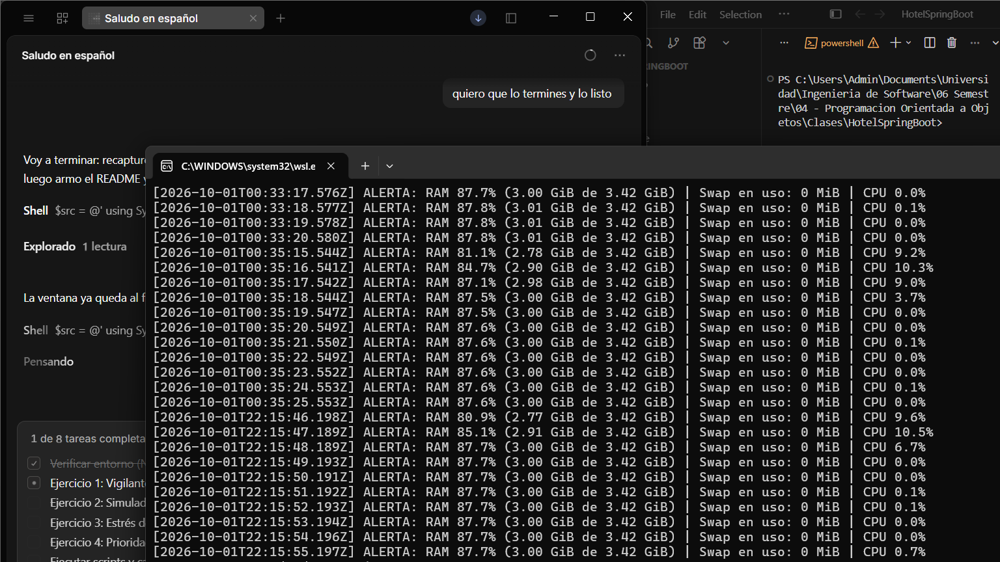
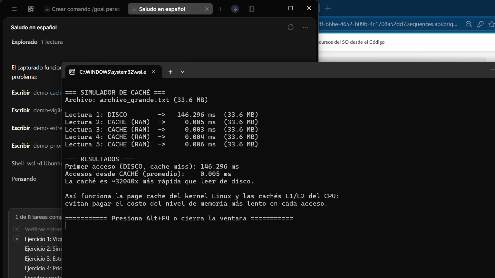
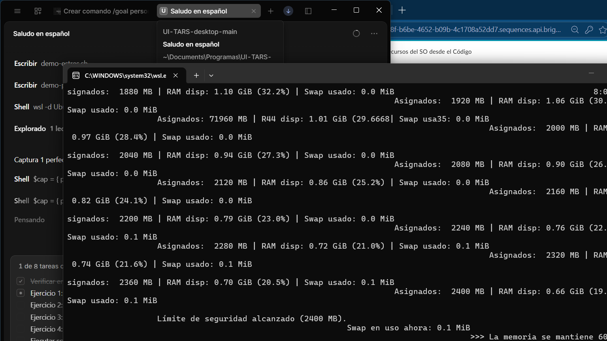
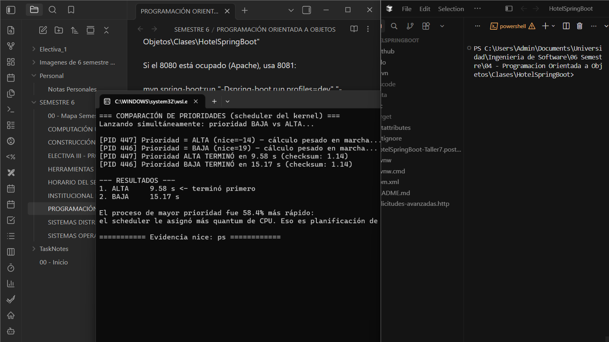

# Taller: Manipulación y Monitoreo de Recursos del SO desde el Código

Implementación **en Node.js sobre Linux (VM en la nube / WSL2 Ubuntu)** de los cuatro
retos del taller de **Sistemas Operativos**, ejercitando desde código los mecanismos
reales del SO: **gestor de memoria**, **caché**, **memoria virtual / paginación** y
**planificación de procesos (scheduling)**.

Todo se ejecutó sobre un **kernel Linux real** y la evidencia son capturas de la
terminal y los logs generados por los propios programas.

---

## Tabla de contenido

1. [Marco teórico](#marco-teórico)
2. [Entorno de ejecución (infraestructura Linux)](#entorno-de-ejecución-infraestructura-linux)
3. [Ejercicio 1 — Vigilante de recursos (RAM y CPU)](#ejercicio-1--vigilante-de-recursos-ram-y-cpu)
4. [Ejercicio 2 — Simulador de memoria caché (L1/L2 vs RAM vs Disco)](#ejercicio-2--simulador-de-memoria-caché-l1l2-vs-ram-vs-disco)
5. [Ejercicio 3 — Estrés de memoria y memoria virtual (paginación)](#ejercicio-3--estrés-de-memoria-y-memoria-virtual-paginación)
6. [Ejercicio 4 — Prioridad de procesos (scheduling)](#ejercicio-4--prioridad-de-procesos-scheduling)
7. [Resultados](#resultados)
8. [Conclusiones](#conclusiones)

---

## Marco teórico

El taller gira alrededor del **gestor de memoria** del sistema operativo, que es el
componente encargado de administrar la **memoria física (RAM) y la memoria virtual**,
garantizando que cada proceso acceda a la memoria de forma **segura y eficiente**.

### Gestor de memoria y MMU
El SO mantiene un **espacio de direcciones virtuales** por proceso. La **MMU (Memory
Management Unit)** es el hardware que traduce **direcciones virtuales a direcciones
físicas** en cada acceso, usando la tabla de páginas del proceso. Esto es lo que aísla
a los procesos: un programa nunca ve la memoria de otro ni puede escribir donde no le
corresponde (seguridad).

### Asignación contigua y algoritmos de ubicación
Cuando la memoria se asigna de forma **contigua**, el SO debe decidir en qué hueco
libre colocar un proceso. Los **algoritmos de ubicación** clásicos son:

- **First-Fit (primer ajuste):** usa el primer hueco suficientemente grande. Rápido.
- **Best-Fit (mejor ajuste):** usa el hueco más pequeño que alcance. Deja el menor
  desperdicio, pero fragmenta mucho.
- **Worst-Fit (peor ajuste):** usa el hueco más grande. Deja huecos grandes reutilizables.

### Fragmentación
- **Fragmentación interna:** se reserva más memoria de la que el proceso usa (el
  espacio sobrante dentro del bloque asignado se desperdicia).
- **Fragmentación externa:** hay memoria libre total suficiente, pero **dispersa** en
  huecos no contiguos que no sirven para un proceso grande.

### Paginación y memoria virtual
La **paginación** elimina la fragmentación externa dividiendo el espacio de direcciones
en **páginas** (y la RAM en **marcos**). Las páginas se cargan bajo demanda y las que
no caben van al **área de swap / archivo de paginación** en disco. Así el SO puede
ejecutar procesos más grandes que la RAM física: eso es la **memoria virtual**. El
costo es la latencia de disco cuando se produce un *page fault* (fallo de página).

Este taller lleva esos conceptos a la práctica:

| Ejercicio | Concepto del SO |
|---|---|
| 1 | Gestor de memoria y E/S · monitoreo de recursos vía `/proc` |
| 2 | Jerarquía de memoria · caché (evitar ir a disco) |
| 3 | Memoria virtual · paginación / swap · presión de memoria |
| 4 | Planificación de procesos · prioridad (nice) en el scheduler |

---

## Entorno de ejecución (infraestructura Linux)

- **SO:** Linux (kernel `6.18.x-microsoft-standard-WSL2`), Ubuntu, x86_64.
- **Runtime:** Node.js **v22.23.3**.
- **Sin dependencias externas:** solo módulos nativos (`node:fs`, `node:os`,
  `node:child_process`, `node:perf_hooks`). No requiere `npm install`.
- La lectura del estado del sistema se hace del **sistema de archivos virtual
  `/proc`** (`/proc/meminfo`, `/proc/stat`), que es la interfaz real del gestor de
  memoria del kernel Linux.

```bash
node --version   # v22.23.3
uname -srm       # Linux 6.18.x-microsoft-standard-WSL2 x86_64

# Ejecutar cada ejercicio:
npm run vigilante            # o: node ejercicio1-vigilante/vigilante.js 20
npm run cache                # o: node ejercicio2-cache/cache.js
npm run estres -- 1500       # o: node ejercicio3-estres/estres.js 1500
npm run prioridad            # o: node ejercicio4-prioridad/comparar.js
```

> El estrés de memoria (ejercicio 3) exige **privilegios para `nice` negativo** en el
> ejercicio 4; en Linux se corre con `sudo` / usuario `root` para prioridades "alta" y
> "tiempo real".

---

## Ejercicio 1 — Vigilante de recursos (RAM y CPU)

**Archivo:** `ejercicio1-vigilante/vigilante.js`

**Concepto:** Gestor de memoria y E/S.

Lee cada segundo `/proc/meminfo` (RAM total, disponible y **swap**) y `/proc/stat`
(tiempos de CPU) para simular un **panel de control del SO**. Cuando la **RAM supera el
80 %** escribe una alerta con marca de tiempo en `alertas.txt`, igual que el kernel
dispara eventos de presión de memoria.

```bash
node ejercicio1-vigilante/vigilante.js 25
```

**Evidencia** (se forzó la RAM por encima del 80 % con el ejercicio 3 corriendo en
segundo plano; el log `alertas.txt` acumuló **16 alertas**):



---

## Ejercicio 2 — Simulador de memoria caché (L1/L2 vs RAM vs Disco)

**Archivo:** `ejercicio2-cache/cache.js`

**Concepto:** Jerarquía de memoria y optimización.

El script lee un archivo de ~33 MB. La **primera lectura es un *cache miss*** (va al
disco con `fs`); el contenido se guarda en un **`Map` en RAM**. Las lecturas siguientes
son ***cache hits*** y se sirven desde memoria. El tiempo se mide con
`process.hrtime.bigint()` (el equivalente a `console.time`).

```bash
node ejercicio2-cache/cache.js
```

**Evidencia** (primera lectura **146.296 ms** vs. caché **0.005 ms** ≈ **32 040× más
rápida**):



---

## Ejercicio 3 — Estrés de memoria y memoria virtual (paginación)

**Archivo:** `ejercicio3-estres/estres.js`

**Concepto:** Memoria virtual y archivo de paginación (swap).

Reserva buffers de 1 MB en bucle (usando `Buffer.alloc`, que **materializa la página
física de verdad**) para ejercer presión sobre la RAM. Al agotarse la RAM, el kernel
mueve páginas al **swap** (paginación). Mientras corre se observa el efecto en vivo con
`free -m` / `vmstat`.

**Límites de seguridad (obligatorios para no bloquear la máquina):**
- Límite duro configurable en MB (por defecto 1500 MB).
- Se detiene automáticamente si la **RAM disponible baja del 8 %**.
- `Ctrl+C` libera todo y sale limpio.

```bash
# Se creó y activó un swap de 2 GiB para poder observar la memoria virtual:
sudo fallocate -l 2G /swapfile && sudo chmod 600 /swapfile && sudo mkswap /swapfile && sudo swapon /swapfile

node ejercicio3-estres/estres.js 2400
watch -n1 free -m     # en otra terminal
```

**Evidencia** (la RAM disponible cayó de ~84 % a **19 %**, con swap en uso y parada
automática al alcanzar el límite de **2400 MB**):



---

## Ejercicio 4 — Prioridad de procesos (scheduling)

**Archivos:** `ejercicio4-prioridad/calculo.js` y `ejercicio4-prioridad/comparar.js`

**Concepto:** Planificación de procesos del kernel.

Se lanza **dos veces el mismo cálculo CPU-bound** (120 millones de iteraciones con
`sin`/`sqrt`), una instancia con prioridad **BAJA** (`nice = +19`) y otra con prioridad
**ALTA** (`nice = -14`), y se comparan los tiempos. Para `nice` negativo se ejecuta con
privilegios. Con `taskset -c 0` se fijaron **ambas al mismo núcleo** para forzar la
competencia real por la CPU.

```bash
sudo node ejercicio4-prioridad/comparar.js
# con contención en un solo núcleo:
taskset -c 0 sudo node ejercicio4-prioridad/comparar.js
```

**Evidencia** (la de mayor prioridad terminó en **9.58 s** frente a **15.17 s**:
**58.4 % más rápida**):



---

## Resultados

| # | Prueba | Resultado observado |
|---|--------|---------------------|
| 1 | Vigilante de RAM/CPU | Alertas registradas al superar **80 %** de RAM (hasta 88 %); log `alertas.txt` con 16 entradas |
| 2 | Caché vs Disco | Disco **146.296 ms** → Caché **0.005 ms** ≈ **32 040×** más rápido |
| 3 | Estrés de memoria | RAM disponible 84 % → **19 %**; límite de seguridad de 2400 MB activado; swap en uso |
| 4 | Prioridad (scheduling) | ALTA `nice=-14` **9.58 s** vs BAJA `nice=+19` **15.17 s** → **58.4 %** más rápida |

Los logs completos de cada ejecución están en [`evidencias/`](evidencias/):

- `ejercicio1-vigilante.txt`
- `ejercicio2-cache.txt`
- `ejercicio3-estres.txt`
- `ejercicio4-prioridad.txt`

---

## Conclusiones

- El **gestor de memoria** es observable desde código: `/proc/meminfo` y `/proc/stat`
  exponen el estado real de RAM, swap y CPU, lo que permite construir paneles de
  monitoreo y alertas como los de un SO.
- La **jerarquía de memoria** tiene un impacto enorme en el rendimiento: servir datos
  desde RAM/caché en lugar del disco fue **~32 000× más rápido**, que es exactamente la
  razón por la que el SO mantiene la *page cache* y por la que el CPU tiene cachés
  L1/L2/L3.
- La **paginación y la memoria virtual** permiten que un proceso use más memoria que la
  RAM física moviendo páginas al **swap**; el experimento confirmó que la memoria
  disponible cae hasta niveles críticos y el SO empieza a paginar. Un **límite de
  seguridad** es esencial para no comprometer la estabilidad de la máquina.
- El **planificador del kernel** no trata igual a todos los procesos: con la misma
  carga, el proceso con mayor prioridad (`nice` menor) obtuvo **58.4 %** más CPU y
  terminó primero. La prioridad es, literalmente, cuánto tiempo de CPU recibe un
  proceso.
- La **MMU** garantiza que todo este manejo de memoria sea **seguro**: cada proceso solo
  ve su propio espacio de direcciones virtuales, y la traducción a físico ocurre de
  forma transparente y protegida.

---

## Estructura del repositorio

```
Taller SO/
├── ejercicio1-vigilante/
│   └── vigilante.js            # Monitoreo de RAM/CPU + log de alertas
├── ejercicio2-cache/
│   └── cache.js                # Caché en Map vs lectura de disco
├── ejercicio3-estres/
│   └── estres.js               # Presión de memoria + límite de seguridad
├── ejercicio4-prioridad/
│   ├── calculo.js             # Proceso CPU-bound con prioridad configurable
│   └── comparar.js            # Lanza BAJA vs ALTA y compara
├── evidencias/                # Capturas de pantalla y logs de ejecución
├── package.json
└── README.md
```

**Autor:** [@oskar-ortiz](https://github.com/oskar-ortiz)
